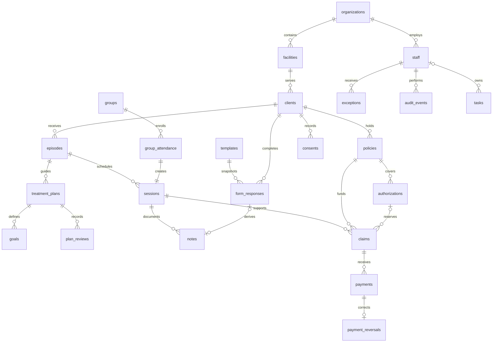

# Implemented data model

The schema in `migrations/` is the source of truth. This document describes the implemented local prototype; the broader proposals in the market research are not all implemented.

Adult-first intake is now an API invariant: new clients, changed birth dates, transitions into intake/active status, and new/activated episodes require age 18 on the facility-local calendar date. Existing records remain intact and permit unrelated corrections. The detailed policy and error contract are in [the API contract](api-contract.md). Persistence is implemented; the complete archive/deletion/retention lifecycle is still open as described in [the scope audit](../development/roadmap-gap-audit.md).

## Identity, ownership and access

Each organization-owned record has an organization UUID. Composite foreign keys tie linked financial and care records to the same organization and, where relevant, the same client. A session cannot point to another person's episode; a claim cannot borrow another client's policy. Clinical links cannot be reassigned after creation.

The six roles are administrator, clinical lead, clinician, billing, executive and support. Clinicians are restricted to primary-assigned clients. Other roles have organization-wide access to their permitted resource categories; `staff.facility_id` is organizational context and is not currently a comprehensive facility access rule. Billing and executives do not receive note, treatment-plan or form-response narratives by default. An exception has a resource, read/write mode, reason, expiry and revocation flag. It cannot grant administrative management, bypass clinician assignment or permit signed-record mutation. Bulk exports have separate role checks.

`x-nexus-actor` exercises this policy locally. Identity verification is intentionally deferred. Authentication must later provide a verified actor through this same policy boundary; accepting a caller-supplied UUID is not a production identity scheme.

## Clinical history

A client is longitudinal; an episode is one course of care. Plans define goals while in draft, then sign and activate. Review entries snapshot the signed goal definitions and add observations. Revision copies the existing plan into a new draft; activation supersedes its predecessor. A group is one shared encounter with distinct attendance records and individual session links, so each person retains separate notes and billing records.

Form responses snapshot the template that was actually used. Required-field validation occurs on review and signing; partial drafts are permitted. Edited reviewed responses return to draft. Exact source excerpts can be linked to answers, with explicit human review. Signed notes and responses preserve originals through linked amendments. A note generated from a form uses the actual labels and answers and remains a draft.

Templates also carry organization-authored stage/care-level rules and a required/suggested flag. Matching considers client stage and the current active episode, otherwise the latest discharged episode. Planned episodes are excluded. Completion counts only responses for that template and relevant episode; a signed response takes precedence, while reviewed responses remain unsigned. Rules guide the chart but do not block admission or discharge or infer legal requirements. Rule edits do not change prior response snapshots.

PATCH uses `_expected_updated_at` to compare the loaded version under the record lock. Missing versions return 428, stale versions 409, and neither creates an update audit. Signed-record immutability remains an additional constraint. Local audio is transient: whisper.cpp produces draft text, authorization/recording consent is checked before and after processing, and only deliberately saved source text becomes part of the form record. Consent calendar dates follow the client's facility timezone.

Discharge closes the episode, completes its active plans and cancels scheduled activity after its end date. It does not erase history or settle receivables. Staff offboarding preserves authorship and transfers open tasks, future appointments and current client assignments.

## Financial integrity

Amounts are integer cents and service units are positive integers. Readiness checks a completed session, signed documentation, policy dates, service/diagnosis codes and any selected authorization. The facility timezone determines the service date. Future sessions cannot be completed, signed or billed as delivered care.

Authorization units are reserved under a lock. Ready, submitted, denied and paid claims consume their units; a denial does not undo the delivered service. Returning an unsubmitted ready claim to draft releases its reservation. Unsubmitted claims may be voided with a reason and replaced without creating two live claims for the same session/service. Submitted claims retain external evidence and cannot be silently rewritten.

Payment posting and full payment reversals lock the claim and recompute net allocations. Payments, reversals and audit events are append only. A reversal has a unique original payment, copied amount, booking date, actor and reason. It reopens a paid balance as appropriate; it does not issue a refund or move money. Cash receipts and adjustments stay separate in metrics and accounting exports.

## Current boundaries

The prototype has one service line per claim. It does not implement payer adjudication, remittance allocations, direct submission, refunds, a general ledger, prescribing, laboratory networks, document attachments or automated clinical decisions. Speech recognition is an optional local adapter; live recording, speaker separation and clinical accuracy validation remain open. Consent rows record attestations and scope; they are not a complete consent/disclosure policy engine or legal signature service. Separate psychotherapy/SUD counseling-note storage is not implemented. Care-team membership beyond the primary clinician, effective-dated facility permissions and richer retention policies remain next-stage work.

Runtime state is PostgreSQL. Test fixtures use separate disposable databases; the ordinary workspace starts empty. Audit events identify actor, action, resource and record without copying clinical bodies into logs. Backups can be restored locally, but production backup encryption, disaster recovery and incident response remain deployment work.
