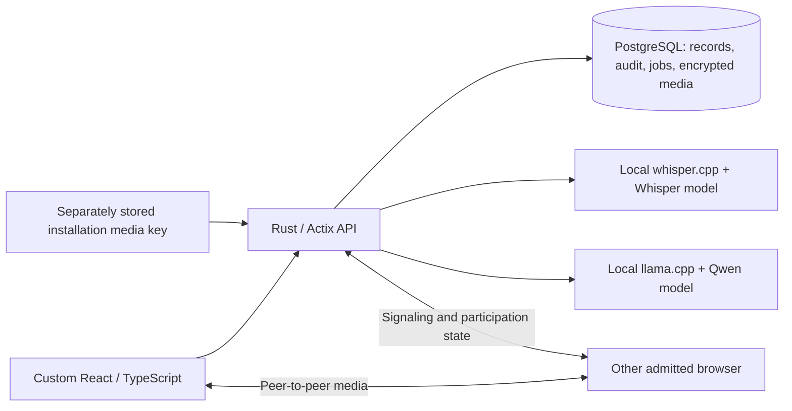

# Architecture overview

Nexus has a persistent local application: a custom React/TypeScript interface, a Rust/Actix API, and PostgreSQL with versioned SQLx migrations. The ordinary database starts empty; the earlier mock API has been replaced.

The same stored client, episode and session link care documentation to claims readiness. Signed records remain immutable; corrections preserve originals. Financial transitions reserve authorization units and serialize payments. Executive metrics come from stored records with clinical narrative restricted by role.

Authentication is deliberately deferred. Local operator selection exercises policies but does not establish identity. Startup requires development mode and a loopback bind. Facility relationships exist, but a complete facility ACL is not implemented.

The active build includes `api/` and `frontend/`. `core/`, `fhir/` and `jobs/` remain parked legacy material. Use root `compose.local.yml` or the portable database helper; older infrastructure files are not a complete deployment design.

This is the current local development structure, not a production deployment diagram. The API owns authorization checks and durable workflow transitions. Model outputs require review and separate signing. Browser video is peer-to-peer; the API does not mix everyone's media into one server recording. Production identity, remote-network relay validation and key recovery remain open. Development Grok calls review selected source/public research outside this patient-data flow; xAI is not an application runtime dependency.

See the [data model](data-model.md), [API contract](api-contract.md), [verification](../development/verification.md) and [delivery plan](../development/delivery-plan.md).
