# Forms, profile pictures and superbills: review and walkthrough

November 21, 2026. Branch `feature/forms-brand-profile-photos`, cut from `dev` at `9fed857`. Written to be copied into the Nexus Notion document.

This records one pass over every input form in Nexus: what was changed, how each form now behaves, what each role can do, and a complete synthetic client journey from registration to a paid claim. It also says plainly what was not checked. Nothing here is a claim of product acceptance; that is the owner's call after looking at it.

## In short

- **Every form now uses one system.** Fields, menus, the calendar, time entry, buttons, dialogs and error messages follow the brand guide: square fields and dialogs, one soft corner on the primary button and on profile tiles, Fraunces headings, "Nov 18, 2026" dates, "3:00 PM" times, and the words "client" and "session".
- **Profile pictures exist.** Staff can upload a photo or choose one of ten Nexus defaults for a client or a team member. Anyone with nothing chosen gets an automatic default of their own, so a list never shows one repeated mark.
- **Superbills exist.** Billing can open an itemized statement for a billed session and print it or save it as a PDF.
- **One synthetic client was taken end to end:** registered, intake completed and admitted, plan of care signed, a video session held, a note signed, a claim created and paid, a superbill produced, and the result visible to the executive.
- **The walkthrough found ten defects in the new work, all fixed during it, and four product gaps that are left for a decision** (listed under [What the walkthrough found](#what-the-walkthrough-found)).

## What was asked for

1. Profile pictures: ways to add them, support for them, and several Nexus-branded defaults so it is not the same icon for everyone.
2. An end-to-end design pass on every form, more in the Nexus theme and using the brand assets (for example a leaf for the date in a calendar).
3. The pattern beside the navigation should fade into the buttons instead of starting abruptly.
4. Every form and every button on it reviewed for all three workspaces and the roles.
5. End-to-end creation of each kind of record: client, session, group, plan of care, and superbills, building superbills if they did not exist.
6. A new client taken through recovery end to end, including a video session, notes, forms, billing and the executive's view.
7. All of it documented in one Markdown file.

## The form system

The brand guide (`brand/Nexus-Brand-Guidelines-v0.4.pdf`) already sets the rules. The earlier form work had drifted from several of them; this pass applies them.

| Rule from the guide | How it is applied |
| --- | --- |
| Anything that holds data or input is square (3 to 6 px) | Fields 4 px, menus and dialogs 6 px. The 12 px dialog and 10 px menu corners are gone. |
| One soft corner, top right, for the primary button, counts and tiles | Primary buttons, section numbers, suggestion chips and profile tiles. Secondary buttons stay square. |
| One primary button per view | Each dialog has one. The session detail dialog had two; "Edit session" is now secondary. |
| Hover opens the corner; pressed closes it and drops 1 px; nothing around it moves | The hover lift and shadow added earlier were removed. |
| A busy button keeps its width and shows the sun | Save buttons show a turning sun and "Saving" at a fixed width. |
| An error is a red outline, an icon and a sentence that says what to enter; typed text is kept | Every form does this, per field (see below). |
| "Nov 9, not 11/09"; "4:12 PM"; name the zone when it could be in doubt | Dates and times read this way everywhere, and forms say "Eastern Time" rather than `America/New_York`. |
| "Client" on every screen; "session" for a scheduled visit; "sign" for making a record final | User-facing text was changed throughout. "Encounter" remains only in billing checks. |
| Contour is the only pattern in the product, under the navigation | Kept, and it now fades in from nothing rather than starting at a hard edge. |
| The leaf is for cards that summarise, never for forms or dialogs | Forms stay square. The one leaf in a form is the chosen day in the calendar, as the owner asked. |

### Fields

**Dates.** A date field shows "Nov 18, 2026". It accepts what people actually type: `11/18/2026`, `11/18` (this year), `111826`, `Nov 18`, `2026-11-18`, `today`, `tomorrow`. The record still stores `2026-11-18`. A two-digit year means this century unless that would be more than ten years ahead, so `3/14/85` is 1985. Text that is not a date is kept and marked: "Enter a date like 11/18/2026 or Nov 18, 2026."

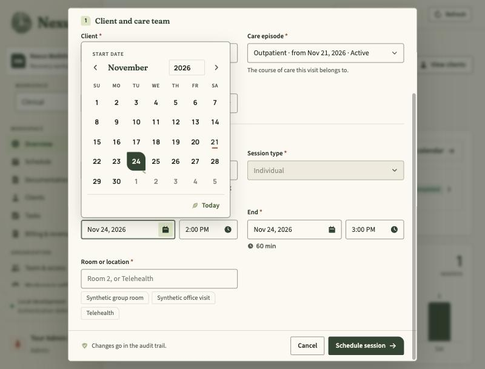

**The calendar.** The chosen day is a leaf (tip top left, stem bottom right). Today has a short clay stem under its number. "Today" carries the new leaf icon. Arrow keys move by day and week, Page Up and Page Down by month, Home and End to the ends of the week. It opens below its field, and above when it would be cut off; when it opens above it names its field ("START DATE") so it is not mistaken for the field it covers.

**Times.** A time field shows "2:00 PM" and accepts `2pm`, `2`, `1400`, `14:00`, `930a`, `noon`. Without AM or PM, 7 to 11 is morning and 12 to 6 is afternoon, and the field then shows which it took. Up and Down move 15 minutes. The clock button opens a list that starts at the current value.

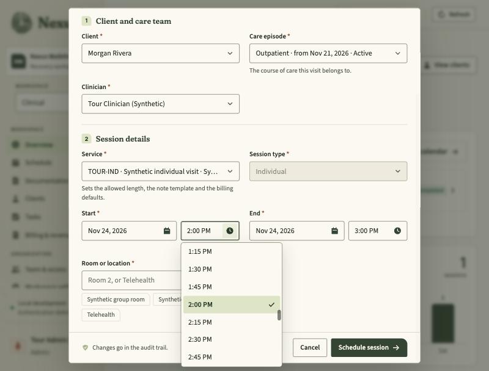

**Menus.** A menu belongs visibly to its field. It opens below, scrolling the form for room first. "Choose…" is an instruction, not an option, so it is no longer listed in a required menu. This is the fix for the screenshot the owner sent, where the Status menu covered the Session type field and looked like its menu.

**Amounts** have a dollar sign inside the field. **Tick boxes** are a square that fills with ink.

### What a form does for you

- **It fills in what it can.** Choosing a client fills the care episode (the one active episode, when there are several), the clinician (the client's own), the service (when the program has one) and the session type. Choosing a session on a claim fills the service code and the charge. A new client starts at the registrar's facility.
- **The end follows the start.** Setting a start time sets the end from the service's usual length; moving the start keeps the visit's length. The length is shown under the end ("60 min").
- **It does not ask what it knows.** A new session is "scheduled" and a new task is "open", so those forms no longer ask for a status.
- **Dependent menus say why they are empty:** "Choose a client first", or "No care episode on file" with the next step.
- **Common answers are one click:** rooms used before, "Telehealth", consent types, pronouns, languages.
- **Dates default sensibly:** a payment is received today; a consent is granted today.
- **An edit says whose record it is,** since the client on a saved record cannot be changed.

### Errors

Every problem is shown on its own field, on the step where that field is, with a sentence that says what to enter. The form also sums up: "Two things to fix before this can be saved: care episode, service." The first field with a problem takes the cursor.

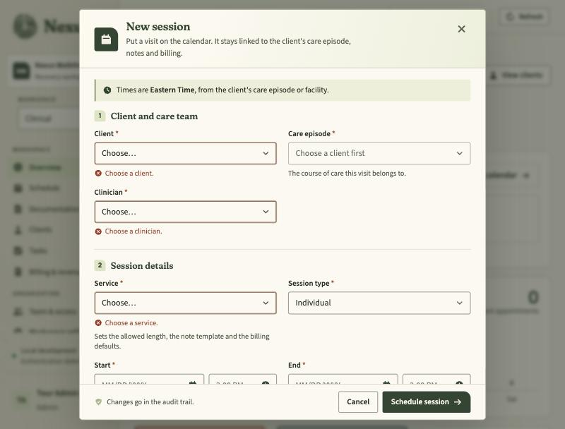

### The dialog

Each dialog has a tile showing what kind of record it is, a Fraunces title, a one-line description in the brand voice, numbered sections when there is more than one, and a footer with "Changes go in the audit trail.", Cancel, and one primary button named for what it does ("Schedule session", "Add policy", "Record payment", "Create client").

## Profile pictures

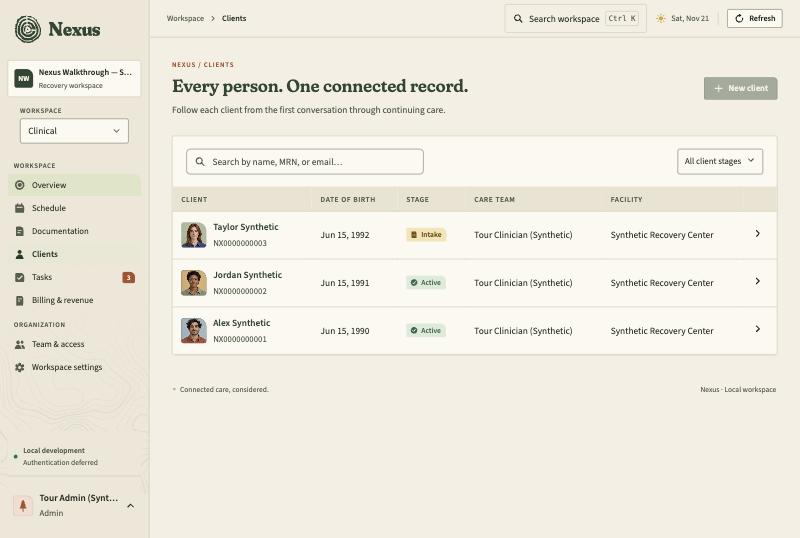

A person's picture is a Nexus tile: three firm corners and one soft corner, top right, as the brand guide sets for avatars. It holds one of three things.

1. **An uploaded photo.**
2. **A chosen Nexus default:** one of the ten motifs from the brand kit (sprig, fern, sprout, pine, hills, river, cairn, tree rings, sun, moon).
3. **The automatic default,** when nothing is chosen: a motif and a colour pairing worked out from the person's id. There are 60 combinations (ten motifs, six pairings of role colours). The same person always gets the same one. A test checks that 200 people do not collapse onto a few.

### Ways to add one

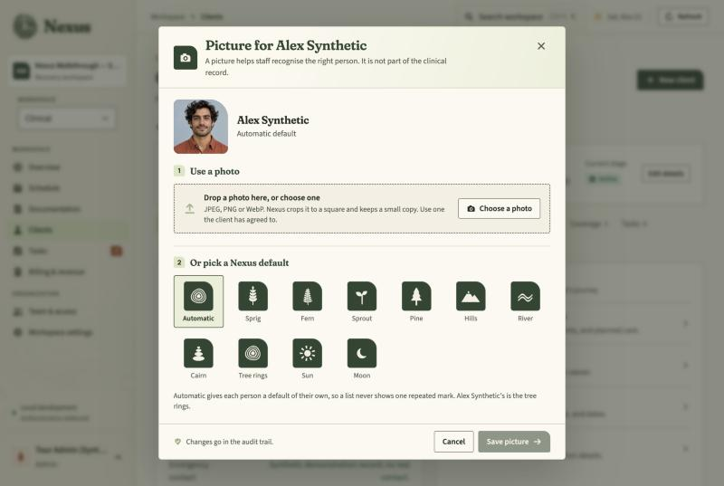

- **A client:** click the picture on their chart.
- **A team member:** "Picture" beside their name in Team & access (administrators), or "Your picture" on your own row.
- **Yourself:** "Change your picture" in the profile menu, bottom left.

The picker takes a dropped or chosen file (JPEG, PNG or WebP), crops it to a centred square and keeps a 256 pixel JPEG. Redrawing the image also drops anything else stored in the file, such as where it was taken. On a phone the file chooser offers the camera. Nothing changes until "Save picture".

### The rules

| Question | Answer |
| --- | --- |
| Who may change a client's picture? | Whoever may change that client: support, clinician, clinical lead, admin. A clinician only for their own clients. |
| Who may see it? | Whoever may see that client. Billing and executive can see it and cannot change it. |
| Who may change a team member's picture? | Anyone, their own. An administrator, anyone's. |
| What files? | JPEG, PNG or WebP that are what they claim, at most 512 KB and 1,024 pixels a side, not animated. SVG is refused because it can carry script. The API reads the image's own header; it does not trust the request. |
| Where is it stored? | A separate table, `profile_pictures` (migration 024). Setting a picture does not touch the client or staff record, so it changes no record version and does not disturb the knowledge index. |
| Is it audited? | Every change, in the same transaction: `set_profile_photo`, `choose_profile_default`, `clear_profile_picture`. |
| Is it cached? | No. The API serves photos `no-store`; the app holds them in memory for the signed-in person only. |
| Other organizations? | A person in another organization does not exist for reading or writing. |

API: `GET` and `PUT /api/profile-pictures/{clients|staff}/{id}`. A `PUT` with an image stores a photo; with `{"motif": "fern"}` chooses a default; with `{"motif": null}` returns to the automatic one. The workspace load carries `avatars`, a map of person id to `"fern"` or `"photo:<tag>"`.

**One open point.** The three seed clients (Alex, Jordan, Taylor) still show the three photographic portraits added in the previous change when nothing else is chosen. There is no record of where those images came from. They are now labelled "Demonstration portrait from the seeded data" in the picker, and choosing anything replaces them. Whether to keep them is the owner's decision.

## Superbills

A superbill is an itemized statement of one billed session that a client can keep or send to their own payer. Nexus had none.

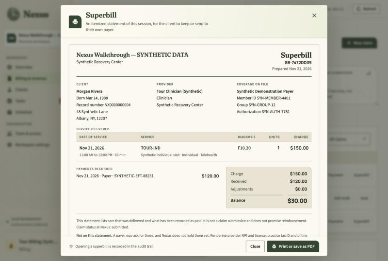

- **Where:** Billing & revenue, Claims, "Superbill" on the claim's row.
- **Who:** billing and admin. It puts demographics, a diagnosis and a charge on one page, so reading claims is not enough; clinical lead, clinician, executive and support are refused, and a temporary access exception does not widen it. Each one opened is audited (`superbill`).
- **Which claims:** the session must be completed and the claim past draft and not voided. A draft is refused with "Mark this claim ready first. A superbill lists charges that passed the readiness checks."
- **What is on it:** the practice and facility, the client (name, date of birth, record number, address), the provider, coverage on file, the date and time of service in the facility's own time, the service code and name, diagnosis code, units, charge, each payment recorded (reversed ones struck through), and the balance.
- **How the balance is worked out:** on the server, in whole cents, from the payment ledger and its reversals. A reversed payment is listed and never counted.
- **It is not stored.** It is assembled from the claim each time, so it cannot drift from the record.
- **Printing:** "Print or save as PDF" prints the statement alone, dark ink on white, whatever theme the workspace is in.
- **What it says it lacks:** Nexus does not yet hold the rendering provider's NPI and license, the practice tax ID and billing address, a diagnosis description, a place of service code, or procedure modifiers. The statement says so, so nobody takes their absence for an oversight.

API: `GET /api/claims/{id}/superbill`.

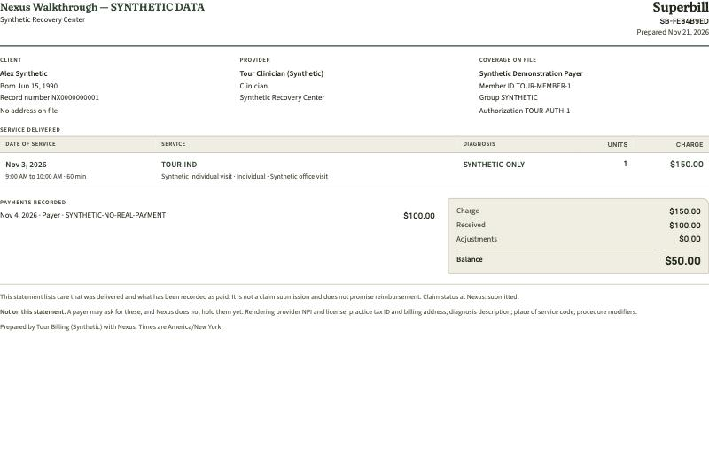

## Every form, reviewed

"Engine" means the form is drawn by the shared record form (`frontend/src/forms.tsx`), so it has sections, per-field errors, self-filling, the busy button and the dialog tile without further work. The others are their own components and were moved onto the same controls and styles and corrected individually.

| Form | Opens from | Kind | What changed in this pass |
| --- | --- | --- | --- |
| New client | New client | Own | Three steps: Person, Care team, Review. Errors on the field and the step they belong to. Contact details open by themselves when filled. Review lists everything entered. Facility pre-chosen. "Create client". |
| Start intake, edit referral | Chart, Intake | Own | New controls; program note styled; "Client report" wording. |
| Identity check | Chart, Intake | Own | New controls. |
| Begin screening, mark ready, admit, decline, withdraw | Chart, Intake | Own | New controls. |
| Consent record | Chart, Consents | Engine | Type offered as one-click choices with what each is checked for. Granted today by default. |
| Form response | Chart, Forms | Own | Dialog tile; the Forms tab opens on the client's current episode so required forms are listed at once. |
| Review and sign a form | Chart, Forms | Engine | Confirmation with no empty body. |
| Treatment plan, goal | Chart, Treatment plan | Engine | Sections; active episode pre-chosen. |
| Plan review | Chart, Treatment plan | Own | Dialog tile. |
| Session | Overview, Calendar | Engine | Sections; self-filling; end follows start; room suggestions; no status on a new session. |
| Group session, participant | Calendar | Engine | Sections; service and facilitator filled. |
| Unavailable time | Calendar, Staff availability | Own | New date and time fields; names the zone. |
| Clinical note | New note | Own | Sections; "Client and session". |
| Sign note, amend note | Note | Engine | "Sign this note?" in the brand's words; "Signed. Billing can see it now." |
| Task | Tasks, Overview | Engine | "What needs doing" then "Who and when"; no status on a new task. |
| Insurance policy | Billing, Coverage | Engine | Sections; hints. |
| Authorization | Billing, Authorizations | Engine | Three sections; policy fills from the client. |
| Claim | Billing, Claims | Engine | Policy, code and charge fill themselves; dollar field; ICD-10 hint. |
| Billing readiness | Claim row | Own | Dialog tile; "Passed" in the success colour. |
| Record submission, record denial, void, return to draft | Claim row | Engine | Per-field errors; plain confirmation. |
| Payment, reverse payment | Claim row | Engine | Received today by default. |
| Superbill | Claim row | New | New. |
| Team member | Team & access | Engine | Sections; says sign-in matches the email. |
| Access exception | Team & access | Engine | Sections. |
| Offboard | Team & access | Engine | Unchanged apart from the shared system. |
| Picture | Chart, Team, profile menu | New | New. |
| Facility | Workspace settings | Engine | Time zone is a menu of named zones, not a typed identifier. |
| Form template | Workspace settings | Engine | Three sections; the question builder was restyled and a stretched tick box fixed. |
| Program, service | Workspace settings | Own | New controls. |
| Telehealth visit | Session | Own | Plain wording; names the zone. |
| Calendar filters, list filters, workspace switcher | Toolbars | Shared | New menu. |
| Exports | Billing | Own | New date fields. |
| First-run setup, sign-in, local operator picker | Entry | Own | Operator picker shows default pictures. Otherwise unchanged. |

## What each role can do

The table states the API's role rules (`api/src/access.rs`, and the picture and superbill modules). **Bold** cells were exercised in the browser during the walkthrough by switching between the six seeded operators; the rest were not.

| | Support | Clinician | Clinical lead | Billing | Executive | Admin |
| --- | --- | --- | --- | --- | --- | --- |
| Register a client | **Yes** | Yes | Yes | **No** | **No** | Yes |
| Start intake, identity check, consent | **Yes** | Yes | Yes | No | No | Yes |
| Complete and sign intake forms | No | Yes | **Yes** | No | No | Yes |
| Admit to care | **No** | Not tried | **Yes** | No | No | Yes |
| Plan of care, notes | No | **Own clients** | Yes | No | No | Yes |
| Schedule a session | Yes | **Yes** | Yes | No | No | **Yes** |
| Host the video visit | No | **Own sessions** | Yes | No | No | Yes |
| Coverage, claims, payments | No | No | Read | **Yes** | **Read only** | Yes |
| Open a superbill | No | No | No | **Yes** | **No** | Yes |
| Change a client's picture | **Yes** | Own clients | Yes | No | **No** | **Yes** |
| Change their own picture | Yes | Yes | Yes | Yes | Yes | Yes |
| Tasks | Yes | Yes | Yes | **Yes** | **Yes** | Yes |

What was seen: support has no Documentation or Billing in the navigation; billing has no "New client"; the executive has no "New claim", no row actions on claims, no Superbill, no camera on the chart picture and no "Edit details". The picture and superbill rows are also covered for every role by the database integration tests.

## A client's journey, end to end

A new synthetic client, Morgan Rivera, in an isolated copy of the walkthrough data. Each step is the real screen and the real API.

| # | Role | Step | Result |
| --- | --- | --- | --- |
| 1 | Support | Register: name, date of birth typed as `3/14/1988`, "goes by", pronouns, language, phone, email, address, emergency contact | A mistyped email was caught on its own field on step 1. Review listed everything. Checked for an existing chart: none. Record number NX0000000004. |
| 2 | Support | Picture: chose the River default | Saved and shown on the chart at once. |
| 3 | Support | Start intake: program, start, referral | Saved. 6 of 9 required checks. |
| 4 | Support | Identity check | 7 of 9. |
| 5 | Support | Consents: treatment, recording, processing | Three records. |
| 6 | Clinical lead | Intake form: answered, reviewed, signed | 9 of 9. |
| 7 | Clinical lead | Admission blocked: the start had been entered two days ahead | Withdrew the intake and started another dated today (see findings). Form signed again. |
| 8 | Clinical lead | Begin screening, mark ready, admit | Client is Active. |
| 9 | Clinician | Plan of care with one measurable goal; sign and activate | Signed. |
| 10 | Clinician | Schedule a telehealth session for today | Episode, clinician and service filled themselves. On the clinical home and the calendar. |
| 11 | Clinician and client | Video visit: clinician opens the visit; client opens their invitation and waits; clinician admits; clinician ends for everyone | Waiting room, admission and ending all worked in two browser tabs. No camera or microphone was available, so media itself was not exercised. |
| 12 | Clinician | Complete the session | Refused while the end time was still ahead ("The session must end before completion…"). Corrected the times; the end followed the start. Completed. |
| 13 | Clinician | Note linked to the session; sign | "Signed. Billing can see it now." |
| 14 | Billing | Policy, then authorization for 12 units | Policy filled from the client. |
| 15 | Billing | Claim for the session | Policy, service code and $150.00 charge filled from the session. |
| 16 | Billing | Readiness | 9 of 9 checks passed, including the signed note, coverage and authorized units. |
| 17 | Billing | Mark ready, record submission, record a $120.00 payment | Claim submitted, $30.00 open. |
| 18 | Billing | Superbill | Charge $150.00, received $120.00, balance $30.00. |
| 19 | Billing | Task for the executive about the $30.00 balance | Created, high priority, linked to the client. |
| 20 | Executive | Overview | Census 3 of 12 places (was 2). Charges $450.00 (was $300.00). Cash $220.00 (was $100.00). Outstanding $80.00 (was $50.00). The task is in their list. |

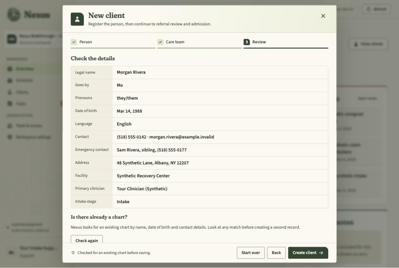
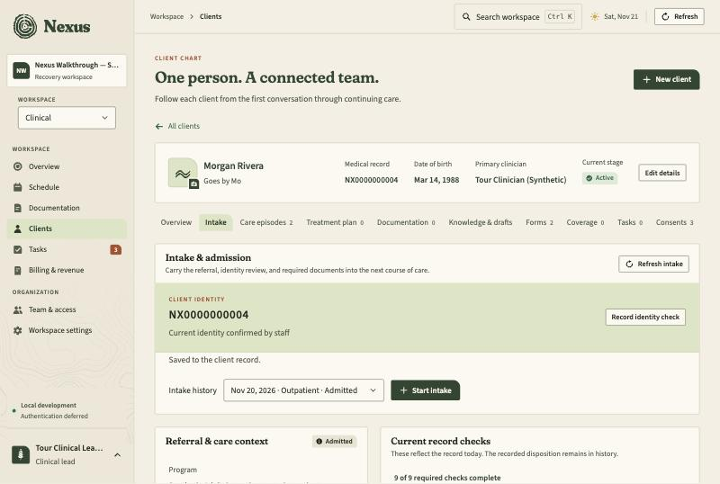
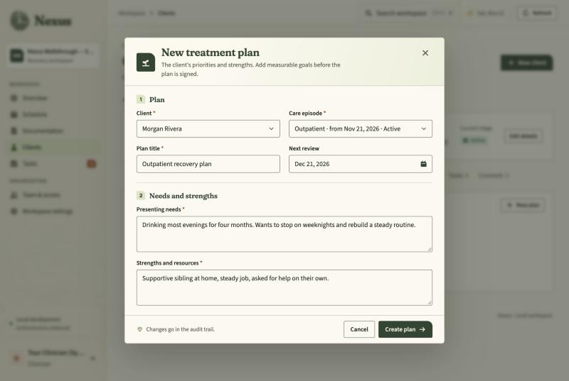
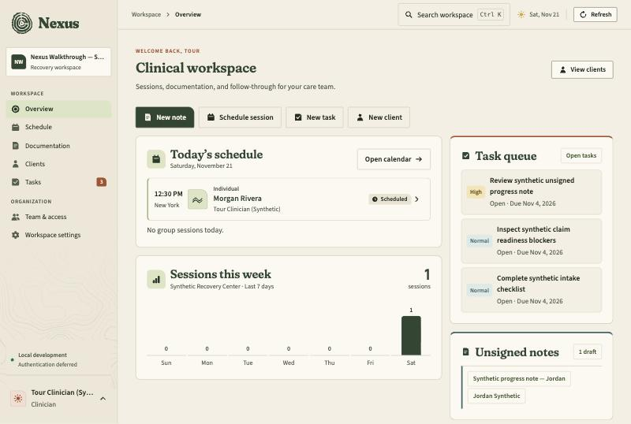
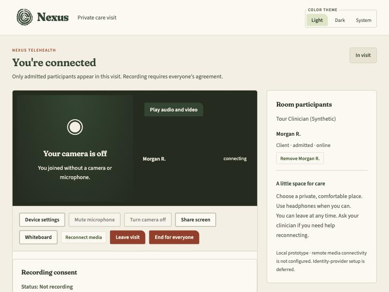
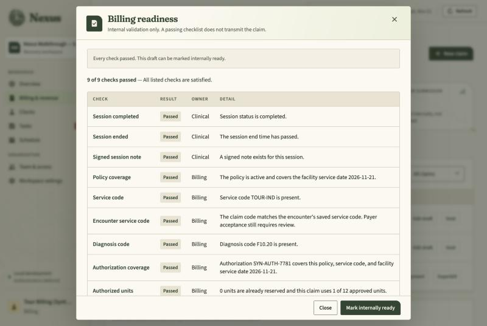
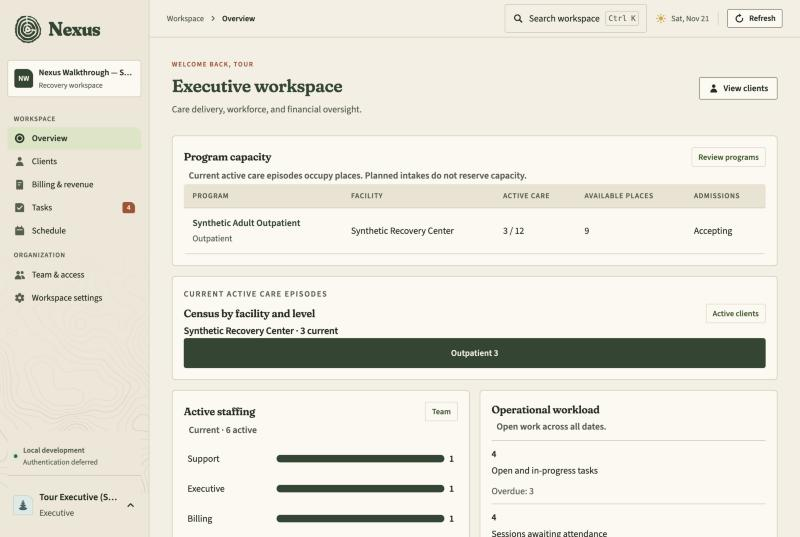

Other screens captured: [consent](review-assets/2026-11-21-forms/08-consent.jpg), [session detail](review-assets/2026-11-21-forms/12-session-detail.jpg), [telehealth setup](review-assets/2026-11-21-forms/13-telehealth-manager.jpg), [note](review-assets/2026-11-21-forms/15-note.jpg), [insurance policy](review-assets/2026-11-21-forms/16-insurance-policy.jpg), [claim](review-assets/2026-11-21-forms/23-claim-form.jpg), [claim in the dark theme](review-assets/2026-11-21-forms/24-claim-form-dark.jpg), [form template](review-assets/2026-11-21-forms/21-form-template.jpg), [phone width](review-assets/2026-11-21-forms/22-phone-calendar.jpg), [registration, step one](review-assets/2026-11-21-forms/06-registration-person.jpg).

## What the walkthrough found

### Fixed during the walkthrough

1. A client with two episodes (one left by a withdrawn intake) got no episode filled in on a new session. It now picks the one active episode and lists active ones first.
2. The Forms tab opened on "all responses", where a required intake form was not listed. It now opens on the client's current episode.
3. The dollar sign covered the first digit of an amount ($150 read as $50). The value was always correct; only the display was wrong.
4. Menu text ran under the chevron on long options.
5. The calendar could be cut off at the bottom of the screen. It now opens upward when it does not fit.
6. The time list jumped back to 12:00 AM when opened.
7. The question builder's "Required" tick box was stretched into a bar with an unreadable label.
8. A confirmation with nothing to fill in showed an empty band.
9. A new client had no facility chosen even with only one facility.
10. Three migration tests counted 23 migrations; there are now 24.

### Left for a decision

1. **An intended start date cannot be corrected on an open intake.** The only way is to withdraw the intake and start again, which also means signing the intake form again. Either the date should be editable until admission, or the form should say so before saving.
2. **A superbill is missing identifiers a payer expects** (NPI, license, tax ID, billing address, place of service). They need somewhere to live: on the organization, the facility and the team member.
3. **Only billing and admin can open a superbill.** A clinician handing one to a client at the end of a session is a common pattern. Whether to allow it is a policy choice.
4. **The three demonstration portraits have no recorded source.**

### Seen but not changed

- A session cannot be completed before its end time. This is deliberate and the message is clear; the form could offer "end now".
- In the browser used for testing, "Open visit in new window" opened in the same tab. Not seen in an ordinary browser; noted in case it recurs.
- Vite reports the entry chunk at 544 kB (was 505 kB), over its 500 kB advisory. The ten motifs and the new components account for the growth.

## What was checked, and what was not

Checked on macOS arm64 against an isolated database (`nexus_formwork`, a copy of the walkthrough data) with its own API on port 8095 and frontend on port 5175.

- **Frontend:** TypeScript check clean. 157 tests pass (142 before): nine new for typed dates and times, six new for default pictures. Production build succeeds.
- **API:** `cargo fmt --check` and `cargo clippy -D warnings` clean. The default test run passes: 158 library tests and 12 token tests, including five new for image checks and three for superbill totals.
- **Database integration:** every PostgreSQL suite CI runs passes, including two new ones: profile pictures (roles, clinician scope, another organization, refused files, audit, client record unchanged) and superbills (roles, qualifying claims, ledger totals with a reversal, another organization, audit).
- **Six worker-ownership tests could not run.** An API process left running since November 18 (port 8098) holds the worker lock in the test database. This is unrelated to this change; stopping that process lets them run.
- **Browser:** every step in the journey above; light and dark themes; 375 pixel phone width for the session form and calendar; the superbill's print layout shown on screen.

Not checked:

- **Camera, microphone and real media in the video visit.** The test browser has no devices.
- **Printing to paper or a PDF through the system print dialog.** The print layout was verified on screen only.
- **Safari and Firefox,** and assistive technology. Keyboard paths were built to the usual patterns and spot-checked, not audited.
- **A real phone.** Width was emulated.
- **The hosted demonstration and hosted sign-in.** Nothing was deployed.
- **The owner's own walkthrough database.** It runs the earlier API, so pictures and superbills do not work at `127.0.0.1:5174` until that API is restarted, which applies migration 024 (one new table).

## Where the code is

| Piece | File |
| --- | --- |
| Menus, date, time fields | `frontend/src/nexus-ui/FieldControls.tsx` |
| Typed date and time parsing | `frontend/src/dateText.ts` |
| Form styles | `frontend/src/nexus-ui/forms.css` |
| Shared record form and every record's definition | `frontend/src/forms.tsx` |
| Registration | `frontend/src/ClientRegistration.tsx` |
| Pictures | `frontend/src/nexus-ui/Avatar.tsx`, `PhotoPicker.tsx`, `avatar.css`, `frontend/src/avatars.ts`, `api/src/profile_pictures.rs`, `migrations/202611210024_profile_pictures.sql` |
| Superbill | `frontend/src/Superbill.tsx`, `superbill.css`, `api/src/superbill.rs` |
| Brand kit additions | `brand/tools/build_icons.py` (leaf, upload, camera, print), `brand/tools/build_frontend.py` (motifs exported to the app) |

## Next

The owner has said animation and motion are the next step. The brand kit already defines the busy sun and an arrival motion that the app does not use yet, and every transition added in this pass honours the reduced-motion setting. Nothing in this pass attempts a motion design.
