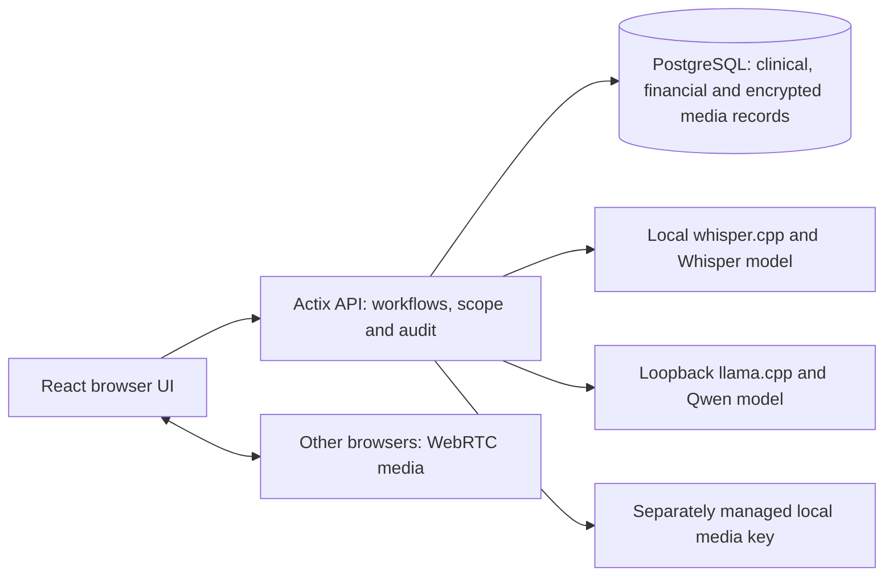

# Repository, architecture and large-commit review

Reviewed November 4, 2026. This combines actual Grok source audits (`architecture-readiness-final-report`, `program-change-review-final-report`, `feature-reality-final-report`) with coordinator inspection and independent OpenAI core review. Worker proposals are evidence to evaluate, not commands to apply. No finding below establishes a runtime reproduction unless explicitly stated.

## Current structure and storage

The active application is a React/TypeScript frontend and one Rust Actix API using SQLx/PostgreSQL. Only `api/` is an active Cargo workspace member; `core/`, `fhir/` and `jobs/` are parked. There is no reason from this review to replace PostgreSQL or split the backend into microservices.

The browser also uses API signaling for WebRTC negotiation. The diagram shows the current local topology, not a production deployment or complete security model. Data is not stored only in the browser. On this Mac, PostgreSQL uses ignored `.local/postgres`; model weights and keys are separate ignored assets. Production hosting would need a controlled API service, PostgreSQL operations, protected model services and a deliberate media/key storage lifecycle.

PostgreSQL is a sound foundation for this domain. SQLite is not categorically unprofessional, but this code already relies on PostgreSQL locks, transactions, JSONB, time-zone support and relational constraints. A database-engine migration would add risk without solving the actual gaps.

## What the large commit changed

Baseline `453c280` on `nexus/integrated-prototype` changed 54 files, adding 7,181 lines and removing 218. It connects organization-defined care programs and services to admission, scheduling, group attendance and billing.

A program belongs to a facility and configured care level, with capacity, age policy and required forms. Services define stable identity, session kind, duration limits, coding defaults, optional charges and documentation templates. Version histories record changes and reasons. Encounters retain service snapshots so subsequent catalog edits do not silently rewrite history. Legacy episodes can be explicitly assigned to a compatible program without inventing a prior admission.

This is meaningful integrated functionality. It is not proof that every program, billing or admission journey has been accepted. Legacy residential/detox labels exist in schema/UI while versioned program configuration targets outpatient/IOP/PHP; labels alone do not establish support for the additional care setting the owner wants.

## Reviewed correctness findings

| Priority | Finding and trigger | Consequence | Proposed change and meaningful verification |
|---|---|---|---|
| High | Case variants of the same service code can pass historical catalog matching while the live-claim unique index uses raw `service_code` | With otherwise valid readiness and no selected authorization, the same session/service may obtain duplicate live claims under differently cased codes | Define canonical service identity consistently; inspect existing collisions before a new migration; enforce normalized live uniqueness without rewriting historical signed/submitted evidence. Test case variants, genuinely distinct services, void/replacement and authorization reservations |
| Medium | Authorization compares service code exactly, while catalog matching trims/uppercases it | A legitimate code spelling can pass catalog matching but fail selected-authorization readiness | Share the applicable canonical comparison; test case/whitespace variants and a genuinely different code |
| Medium, latent | `claimServiceDefaults` returns dollars under `amount_cents`; claim-form initialization can divide that helper result again if a preselected session is provided | A future/preselected create path could display a charge at 1/100 of its intended amount | Make display/storage units explicit at both call sites; test 12500 cents → 125.00 display → 12500 submission, plus zero/missing-default validation (zero is not a valid saved claim amount) |
| Follow-up | Both payment receipts and reversals use UTC for their future-date bound while some other workflows use facility-local dates | Near midnight, acceptance can differ from an operator's intended business-date policy | Define one accounting/business-date basis for receipts and reversals; then test both sides of UTC midnight. Do not patch only reversal dates |

Source anchors for the first two findings: `api/src/programs/services.rs:482`, `api/src/readiness.rs:85`, `migrations/202611020008_billing_corrections.sql:5`, and the free-text claim write path in `api/src/records.rs`/`api/src/routes.rs`. Core review inspected these paths; no new database reproduction was run for this research finding. Treat the duplicate economic charge risk as the first financial regression to reproduce and close before billing acceptance.

For the money initializer, source inventory found **no mounted claim-create caller passing `initial.session_id`**. Existing session selection writes the helper's dollar value directly, and serialization converts it back to cents. The normal reachable selection flow therefore does not demonstrate the undercharge. Changing the helper to cents alone would break that working path by 100×; review both paths together. Relevant files: `frontend/src/forms.tsx:577`, `frontend/src/forms.tsx:616`, `frontend/src/programRouting.ts:30`, `frontend/src/serialize.ts:22`, and `frontend/src/App.tsx`.

Two earlier Mac regressions were actually reproduced and locally fixed: empty optional catalog references now serialize as null, and equivalent RFC3339 timestamps compare as exact instants. Focused tests/build passed as recorded in [verification](../../development/verification.md). Those fixes predate this final research synthesis and remain uncommitted with the owner's other work.

## Worker findings rejected or narrowed during review

- **Admission capacity bypass:** rejected. `admission_program_capacity` does start with `admission_`; the transition checks those blockers under the existing lock before activation. A database trigger provides additional enforcement. The worker contradicted both the prefix and supplied code.
- **Wrong episode state saved as admission evidence:** rejected. The evidence insert stores program/checklist snapshots and IDs, not the claimed embedded episode-status snapshot. Reloading an episode would not fix the alleged problem.
- **Catalog revision insert can fail after a committed version update:** rejected for the normal API path. Version and revision writes share a transaction and propagate failure. Direct administrative SQL integrity is a separate operations/schema-hardening question.
- **Editing a retired service is necessarily a defect:** not established. Historical encounter snapshots remain intact; edits/reactivation are versioned policy choices. No owner requirement freezes every retired catalog field.
- **WAV recognition returns a transcript after failed completion authorization/audit:** rejected. Completion reauthorization/audit is awaited with error propagation before the HTTP success response is constructed.
- **Current default-charge creation is proven wrong:** narrowed to the latent initializer contract above; the mounted selection path is coherent.
- **Scaling failure already measured:** rejected. All-row bootstrap and organization-wide write locks create legitimate risks, but no load test establishes a capacity threshold.

This review illustrates why worker severity labels and test proposals are not accepted automatically. No speculative rewrite or rejected fix was applied.

## Structural priorities

**1. Identity and scope.** `x-nexus-actor` is a local operator assertion, not authentication. Keep local development loopback-only and synthetic. Production identity must bind a verified principal to permitted organization/facility/care-team/patient/proxy scope. Existing resource and primary-clinician rules are valuable foundations, but they are not the complete access model.

**2. Field-level response contracts.** Bootstrap serializes whole permitted rows. Executives can currently receive client emergency-contact and claim diagnosis fields despite narrative restrictions. Define minimal role-specific projections and enforce them server-side across list, detail, person-preview, export and reporting routes. UI concealment is insufficient.

**3. Financial event model.** Current one-service claims and local status/reference transitions cannot support every requested revenue workflow. Separate economic charges, claim versions, transmission attempts, receiver acknowledgments, adjudication, receipts, allocations, adjustments, reversals/refunds, patient responsibility and reconciliation. Preserve integer cents, stable lineage, audit transactions and explicit corrections. See the [billing contract](outpatient-billing-contract.md).

**4. Query/write growth.** Bootstrap reads authorized collections and computes aggregates in memory; ordinary mutations serialize by organization. Add scoped pagination, explicit server aggregates, query measurements and realistic concurrent workflows. Change lock granularity only after proving invariant-preserving alternatives. Do not remove locks merely to make a benchmark faster.

**5. Recovery and lifecycle.** Restore ciphertext with the correct separate media key; test recovery after machine/key loss, not only restoration on the same installation. Define protected backup retention, key rotation/recovery, attachment/media storage, holds and source/derivative destruction. Plaintext temporary media also needs crash-cleanup consideration.

**6. Reproducible development and delivery.** The current Mac launcher and runtime assets are ignored machine-local helpers. Formalize a portable bootstrap and documented environment contract without committing keys or data. Existing Windows instructions remain historical/platform-specific. Docker execution, production packaging and hosted operations need separate evidence.

**7. Branch and CI practice.** Use `codex/` branches and small dependency-coherent changes. Serialize migrations, shared routes and frontend entry wiring. The local CI change now covers the integration branch and `codex/**`; it has not run remotely. Branch protection, the legacy security workflow and manual image-publication gating remain unverified. No commit, push or deployment was performed by this research pass.

## Next coherent work slices

1. Reproduce and close canonical service-code/duplicate-charge invariants, with a collision-safe migration plan if required.
2. Define financial event/packet contracts and implement one complete outpatient service-to-reconciliation scenario, including corrections and denied permissions.
3. Complete role-specific response scope and the missing patient/caregiver/clinical modules from the ledger in parallel, with one owner per shared contract.
4. Implement scoped reporting from those records, then run integrated owner journeys, restart/restore and platform media checks.
5. Apply the approved brand/component system after functional acceptance reaches the agreed stage.

These are sequencing proposals, not a reduction of the [50-capability scope](../../product/acceptance-ledger.md). The November 13 target remains high risk until each capability has integrated acceptance evidence. External integration deferral does not remove internal remittance, statements, reconciliation, patient access or reporting from the target.

## Context-audit reconciliation

The Grok context worker correctly emphasized short entry instructions, maintained handoffs, source hashes and historical-document labeling. It could not verify Mac ports, counts, local model runs or the new Python runner because those files/runtime evidence were outside its packet. The coordinator had independently inspected those facts and recorded the verification; they were not removed merely because a worker lacked them. Official AGENTS discovery guidance was also checked separately. A worker's missing evidence is not proof that a documented implementation is absent.

Useful resulting corrections: the coding guide now points active domain work to `api/src` instead of parked `core/`; database docs distinguish Windows `nexus_ui_test` from Mac `nexus_walkthrough`; older scope/delivery documents explicitly identify historical gaps and budgets. The current shared ledger was inspected at $1,500. The worker's proposal to cut the November 13 scope was not adopted: the owner explicitly retains all planned internal capabilities.
