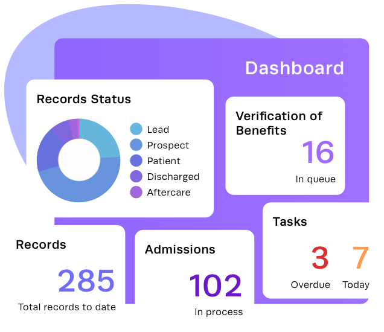
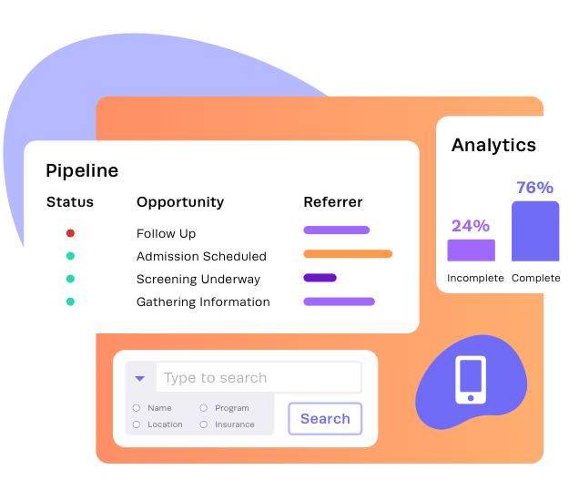
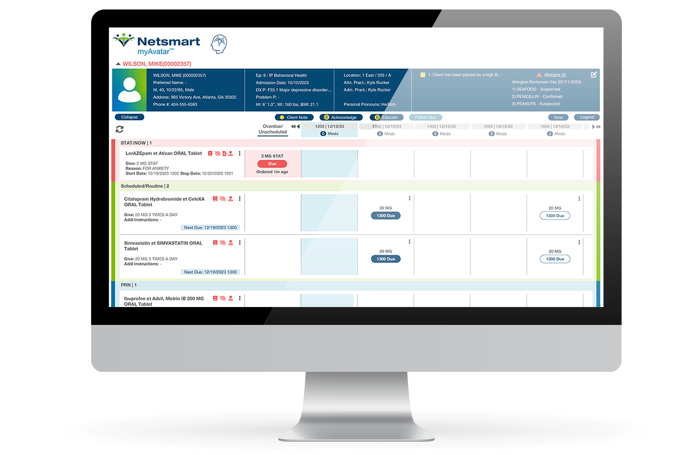
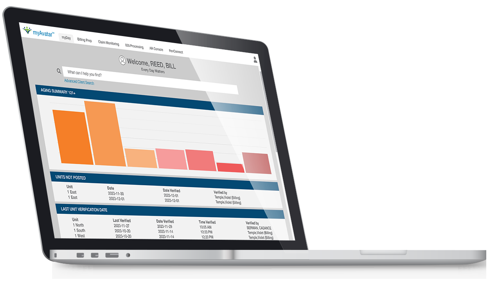
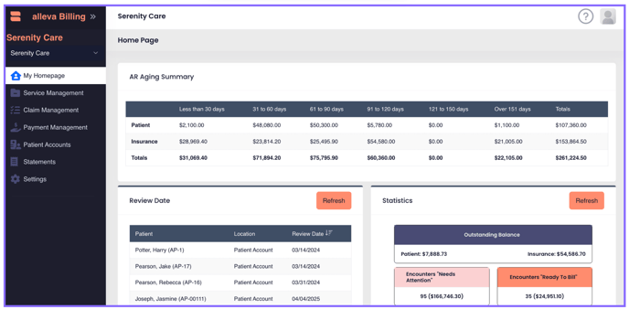

# Competitor visual reference manifest

Retrieved and visually inspected November 2, 2026. These are unmodified public publisher assets retained for internal product research and comparison. Copyright and trademarks remain with their respective owners. They are not Nexus designs, screenshots of a tested tenant, or permission to redistribute as Nexus marketing assets. Do not copy example identities or figures into application data. Review reuse rights before public distribution.

| File | Publisher page | Original asset | Classification and observation |
|---|---|---|---|
| [kipu-admissions.png](kipu-admissions.png) | [Kipu CRM](https://www.kipuhealth.com/products/behavioral-health-crm/) | [PNG](https://www.kipuhealth.com/wp-content/uploads/2023/10/crm-illustration-01-admissions.png) | Marketing illustration, not actual UI screenshot. Visually shows status, benefits queue, admissions, and tasks. Cannot establish production navigation. |
| [kipu-business-development.png](kipu-business-development.png) | [Kipu CRM](https://www.kipuhealth.com/products/behavioral-health-crm/) | [PNG](https://www.kipuhealth.com/wp-content/uploads/2023/10/crm-illustration-02-business-development-02.png) | Marketing illustration. Pipeline stages, search, and analytics demonstrate intended concepts only. |
| [myavatar-clinical.png](myavatar-clinical.png) | [Netsmart myAvatar](https://www.ntst.com/offerings/myavatar) | [PNG](https://www.ntst.com/-/media/images/myavatar_clinical_screenshot.png?h=815&hash=173FD03BFA2E2266D0E065C5A3A959A9&la=en&w=1250) | Vendor-published application screenshot in monitor artwork. Patient banner, medication timing rows, status/actions. Dense operational display; no inference about usability or real patient identities. |
| [myavatar-financial.png](myavatar-financial.png) | [Netsmart myAvatar](https://www.ntst.com/offerings/myavatar) | [PNG](https://www.ntst.com/-/media/images/myavatar_financial_screenshot.png?h=725&hash=553DC13E98A26E098B3D680A3904A520&la=en&w=1250) | Vendor-published application screenshot in laptop artwork. Aging chart, financial tabs, unposted/verification work. Static image cannot demonstrate performance or permissions. |
| [alleva-billing.png](alleva-billing.png) | [Alleva billing overview](https://support.helloalleva.com/alleva-billing-overview) | [PNG](https://support.helloalleva.com/hs-fs/hubfs/Screenshot%202025-04-29%20at%2011-12-58%E2%80%AFAM-png.png?height=339&name=Screenshot+2025-04-29+at+11-12-58%E2%80%AFAM-png.png&width=688) | Official support screenshot. Left navigation separates services, claims, payments, accounts, statements; home includes aging, review dates, and statistics. Example data remain publisher content. |

## Gallery

### Kipu admissions illustration

### Kipu business development illustration

### Netsmart clinical screenshot

### Netsmart financial screenshot

### Alleva billing screenshot

## Capture limitations

These files were downloaded directly from URLs linked by the cited official pages and inspected as images. They are publisher snapshots, not browser captures of a logged-in workflow. No Figma source or customer system was accessed. Lightning Step's image links were discoverable but did not render in the web retrieval tool; they were not used as visual evidence.
